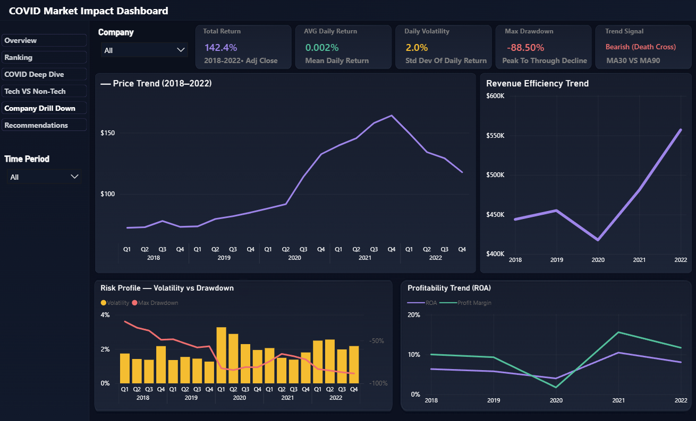
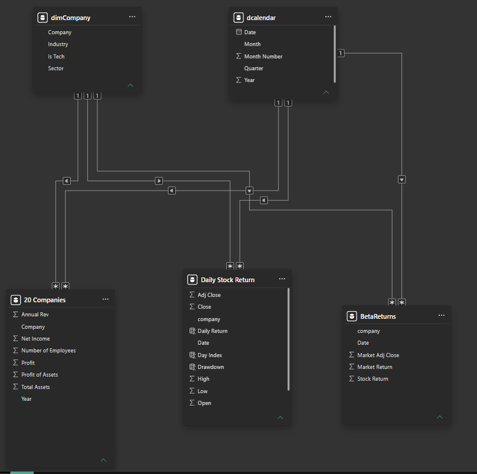

# 📊 COVID Market Impact Dashboard

**A Power BI analytics project examining how COVID-19 reshaped stock performance, risk, and profitability across 20 Fortune-500-class companies (2018–2022), comparing Technology vs. Non-Technology sectors.**


---

## 🔎 Overview

This project analyzes the financial market impact of COVID-19 on 20 major companies, split into **Technology** and **Non-Technology** cohorts, using five years of daily stock data (2018–2022) and annual company financials. It combines classic financial risk/return analytics (total return, volatility, drawdown, beta, Sharpe ratio) with a dedicated pandemic-shock analysis (drawdown depth, recovery speed) and closes with an investor-facing recommendation framework.

📄 Full write-up: [`docs/COVID_Market_Impact_Dashboard_Documentation.docx`](docs/COVID_Market_Impact_Dashboard_Documentation.docx)
📝 Short summary: [`docs/COVID_Market_Impact_Dashboard_Brief_Description.md`](docs/COVID_Market_Impact_Dashboard_Brief_Description.md)

---

## 🖼️ Dashboard Preview

### Overview


### Ranking


### COVID Deep Dive


### Tech vs Non-Tech


### Company Drill Down


### Recommendations


---

## 🧱 Data Model

Star-schema design — 2 dimension tables + 3 fact tables, ~50,850 rows total, ~90 DAX measures.



| Table | Type | Rows | Purpose |
|---|---|---|---|
| `dimCompany` | Dimension | 20 | Company, Sector, Industry, Tech/Non-Tech flag |
| `dcalendar` | Date dimension | 1,826 | Custom calendar (`CALENDARAUTO()`) — Year, Quarter, Month |
| `20 Companies` | Fact (annual) | 100 | Revenue, Net Income, Total Assets, Profit, Employees |
| `Daily Stock Return` | Fact (daily) | 24,515 | OHLCV price history, daily return, running max close, drawdown |
| `BetaReturns` | Fact (daily) | 24,495 | Stock return vs. market return, used for beta calculation |

---

## 📈 Report Pages

| Page | Focus |
|---|---|
| **Overview** | Headline KPIs, total return ranking, Tech vs Non-Tech price trend |
| **Ranking** | Risk-adjusted return, drawdown, beta, and profitability rankings |
| **COVID Deep Dive** | Pandemic-specific drawdown & recovery analysis by company and sector |
| **Tech VS Non-Tech** | Sector-level return, volatility, revenue, and stability comparison |
| **Company Drill Down** | Interactive single-company view (price trend, risk profile, fundamentals) |
| **Recommendations** | Investor-profile guidance (Growth / Balanced / Conservative) with a hypothetical $10K return simulation |

---

## 🧮 Key Metrics Calculated

- Total Return, Daily Return, Volatility (σ), Max Drawdown
- Market Beta, Sharpe / Risk-Adjusted Return
- ROA, Profit Margin, Revenue per Employee
- COVID-specific Drawdown & Recovery %
- MA30 / MA90 trend signal (Golden Cross / Death Cross)

---

## 🏆 Key Findings

- **Tesla** delivered the highest total return (**+476.5%**) and the strongest COVID-era recovery (**+877%**).
- **American Airlines** posted the worst total return (**-76.0%**) and deepest COVID drawdown (**-84.5%**).
- **Apple** had the best risk-adjusted return, making it the strongest balanced pick.
- **Johnson & Johnson** was the most stable holding (lowest daily volatility, σ = 1.08%).
- **Tech companies** outperformed Non-Tech by **+67 points** on average return and recovered from the pandemic roughly **2.4× faster**.

---

## 🛠️ Tech Stack

- **Microsoft Power BI Desktop** — data modeling, DAX, report design
- **DAX** — ~90 measures across return, risk, profitability, and sector-comparison logic
- **Star Schema** — dimensional modeling for scalable filtering across Company, Sector, and Time

---

## 📂 Repository Structure

```
covid-market-impact-dashboard/
├── README.md
├── LICENSE
├── .gitignore
├── docs/
│   ├── COVID_Market_Impact_Dashboard_Documentation.docx   # Full project documentation
│   └── COVID_Market_Impact_Dashboard_Brief_Description.md # Short project summary
├── screenshots/                                            # Dashboard page exports
├── data/                                                    # Source/raw data (add your files here)
└── PowerBI/                                                  # .pbix file (add your file here)
```

> **Note:** The `.pbix` file and raw source data are not included in this repository. Add your own `.pbix` to `PowerBI/` and source CSVs to `data/` before pushing — see `.gitignore` for what's excluded by default.

---

## 🚀 Getting Started

1. Clone this repo.
2. Open the `.pbix` file (once added to `PowerBI/`) in **Power BI Desktop**.
3. Refresh the data source connections if prompted.
4. Explore the report pages via the left-hand navigation rail.

---

## 📄 License

This project is licensed under the MIT License — see [`LICENSE`](LICENSE) for details.

---

## 👤 Author

**Mohamed Bassem**
