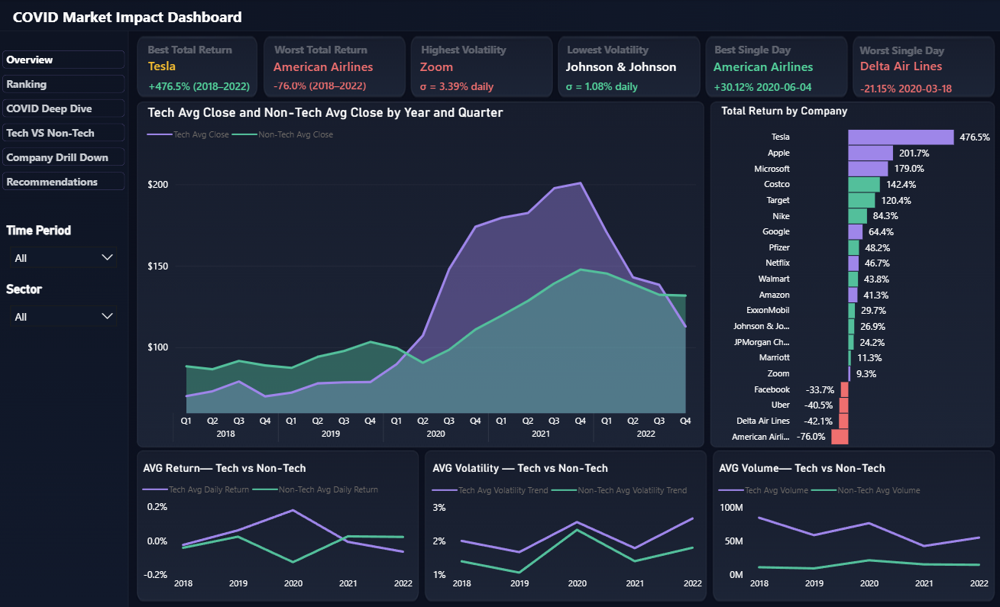

# 📊 COVID Market Impact Dashboard

**A Power BI analytics project examining how COVID-19 reshaped stock performance, risk, and profitability across 20 Fortune-500-class companies (2018–2022), comparing Technology vs. Non-Technology sectors.**


---

## Project Overview

This project analyzes the financial market impact of COVID-19 on 20 major companies, split into **Technology** and **Non-Technology** cohorts, using five years of daily stock data (2018–2022) and annual company financials. It combines classic financial risk/return analytics (total return, volatility, drawdown, beta, Sharpe ratio) with a dedicated pandemic-shock analysis (drawdown depth and recovery magnitude) and closes with an investor-facing recommendation framework.

The data was modeled into a **Star Schema** (2 dimension tables + 3 fact tables, ~50,850 total rows) and visualized through an interactive Power BI dashboard containing **six analytical pages**, driven by **81 DAX measures**. The `.pbix` and source CSVs are not committed here, but the measures and values below were verified against an author-supplied local copy.

📄 Full write-up: [`docs/COVID_Market_Impact_Dashboard_Documentation.docx`](docs/COVID_Market_Impact_Dashboard_Documentation.docx)
📝 Short summary: [`docs/COVID_Market_Impact_Dashboard_Brief_Description.md`](docs/COVID_Market_Impact_Dashboard_Brief_Description.md)

---

## Project Structure

```
covid-market-impact-dashboard/
│
├── PowerBI/
│   └── COVID_Market_Impact_Dashboard.pbix     # Power BI dashboard file (add before committing)
│
├── data/                                      # Scaffold only: source CSVs are not committed
│   ├── daily_stock_prices.csv                 # Planned: daily OHLCV price history (2018–2022)
│   ├── company_financials.csv                 # Planned: annual revenue, net income, assets, employees
│   └── market_index.csv                       # Planned: daily market benchmark for beta calculation
│
├── docs/
│   ├── COVID_Market_Impact_Dashboard_Documentation.docx   # Full project documentation
│   └── COVID_Market_Impact_Dashboard_Brief_Description.md # Short project summary
│
├── screenshots/
│   ├── 01-overview.png
│   ├── 02-ranking.png
│   ├── 03-covid-deep-dive.png
│   ├── 04-tech-vs-nontech.png
│   ├── 05-company-drilldown.png
│   ├── 06-recommendations.png
│   └── 07-data-model.png
│
├── .gitignore
├── LICENSE
└── README.md
```

---

## 🖼️ Dashboard Preview

### Overview


### Ranking


### COVID Deep Dive


### Tech vs Non-Tech


### Company Drill Down


### Recommendations


---

## 📊 Data Architecture

The project follows a simplified two-stage flow: raw daily price and annual financial data are cleaned and shaped in **Power Query**, then loaded into a **Star Schema** in the Power BI data model for high-performance analytical queries.

```
Raw Sources (daily prices, annual financials, market index)
        │
        ▼
  Power Query (cleaning, type casting, column derivation)
        │
        ▼
  Star Schema Data Model  →  DAX Measures  →  6-Page Power BI Report
```


---

## 🛠️ Data Catalog

The model uses a **Star Schema** with one date dimension, one company dimension, and three fact tables (as seen in the Power BI Model View).

### 1. `dimCompany` (Dimension Table)

**Purpose:** Stores static company classification attributes used to segment every other table.

| Column Name | Data Type (Power BI) | Description |
|---|---|---|
| `Company` | Text | Company name (Primary Key) |
| `Sector` | Text | Broad sector classification (e.g., Technology, Retailing, Transportation) |
| `Industry` | Text | Detailed industry classification (e.g., Airlines, Computer Software) |
| `Is Tech` | Text | Binary flag: `Tech` or `Non-Tech`, drives the sector-comparison pages |

### 2. `dcalendar` (Date Dimension Table)

**Purpose:** Custom calendar table generated in DAX, marked as the official Date Table to enable native time-intelligence functions.

| Column Name | Data Type (Power BI) | Description |
|---|---|---|
| `Date` | Date | Continuous daily calendar generated with `CALENDARAUTO()` |
| `Year` | Whole Number | Calendar year |
| `Quarter` | Text | Quarter label (e.g., "Q3") |
| `Month` | Text | Three-letter month abbreviation |
| `Month Number` | Whole Number | Numeric month (1–12), used for correct chronological sorting |

```dax
dcalendar =
ADDCOLUMNS(
    CALENDARAUTO(),
    "Year", YEAR([Date]),
    "Quarter", "Q" & QUARTER([Date]),
    "Month", FORMAT([Date], "mmm"),
    "Month Number", MONTH([Date])
)
```

### 3. `20 Companies` (Fact Table — Annual)

**Purpose:** Stores annual financial statement data used for profitability and efficiency metrics.

| Column Name | Data Type (Power BI) | Description |
|---|---|---|
| `Year` | Date | Fiscal year of the record |
| `Company` | Text | Foreign key to `dimCompany` |
| `Number of Employees` | Whole Number | Headcount for the fiscal year |
| `Annual Rev` | Decimal Number | Total annual revenue |
| `Net Income` | Decimal Number | Net income for the fiscal year |
| `Total Assets` | Decimal Number | Total assets on the balance sheet |
| `Profit` | Decimal Number | Net profit margin (Net Income / Revenue) |
| `Profit of Assets` | Decimal Number | Return on assets, ROA (Net Income / Total Assets) |

### 4. `Daily Stock Return` (Fact Table — Daily)

**Purpose:** Core price-history fact table; the source for return, volatility, and drawdown calculations.

| Column Name | Data Type (Power BI) | Description |
|---|---|---|
| `Date` | Date | Trading date, foreign key to `dcalendar` |
| `company` | Text | Foreign key to `dimCompany` |
| `Open`, `High`, `Low`, `Close` | Decimal Number | Daily OHLC price |
| `Adj Close` | Decimal Number | Dividend/split-adjusted closing price, used by COVID Recovery and Normalized Index; Total Return uses `Close` |
| `Volume` | Whole Number | Daily trading volume |
| `Daily Return` | Decimal Number | Intraday return calculated as `(Close - Open) / Open` |
| `Running Max Close` | Decimal Number | Rolling maximum of `Close` to date, used to compute drawdown |
| `Drawdown` | Decimal Number | % decline from `Running Max Close` to current `Close` |
| `Day Index` | Whole Number | Sequential trading-day counter per company; the verified COVID measures use calendar-date windows |

### 5. `BetaReturns` (Fact Table — Daily)

**Purpose:** Pairs each company's daily return against a market benchmark return specifically to support beta calculation.

| Column Name | Data Type (Power BI) | Description |
|---|---|---|
| `company` | Text | Foreign key to `dimCompany` |
| `Date` | Date | Trading date, foreign key to `dcalendar` |
| `Stock Return` | Decimal Number | Company's daily return |
| `Market Adj Close` | Decimal Number | Benchmark index adjusted close |
| `Market Return` | Decimal Number | Benchmark index daily return |

---

### Star Schema Relationships

| From | To | Cardinality | Key |
|---|---|---|---|
| `dimCompany` | `20 Companies` | 1 → * | `Company` |
| `dimCompany` | `Daily Stock Return` | 1 → * | `Company` |
| `dimCompany` | `BetaReturns` | 1 → * | `Company` |
| `dcalendar` | `Daily Stock Return` | 1 → * | `Date` |
| `dcalendar` | `BetaReturns` | 1 → * | `Date` |

This structure lets every visual filter simultaneously by company attributes (Sector, Is Tech) and date attributes (Year, Quarter) without duplicating logic anywhere in the model.

---

## 🔬 Data Dictionary: Key Field Analysis

This section describes the verified analytical role of the most important fields. Expressions below were checked against an author-supplied local copy of the `.pbix`; the file itself is not committed to this repository.

| Field Name | Source Table | Analytical Role & DAX Pattern |
|---|---|---|
| **Adj Close** | `Daily Stock Return` | Used by **COVID Recovery** and **Normalized Index**. **Total Return** instead uses `Close`: `DIVIDE([Ending Close] - [Starting Close], [Starting Close])` at the first/last date per company. |
| **Daily Return** | `Daily Stock Return` | Intraday return calculated as `DIVIDE([Close] - [Open], [Open])`. **Volatility** is `STDEV.S('Daily Stock Return'[Daily Return])`; **Sharpe Ratio** is `DIVIDE(AVERAGE('Daily Stock Return'[Daily Return]), [Volatility])` with no risk-free-rate subtraction. |
| **Running Max Close / Drawdown** | `Daily Stock Return` | Rolling maximum of `Close` and `DIVIDE([Close] - [Running Max Close], [Running Max Close])`; **Max Drawdown** is `MIN([Drawdown])` per company. |
| **Stock Return / Market Return** | `BetaReturns` | **Beta** is the covariance of stock and market returns divided by market-return variance, implemented with `AVERAGEX` over `BetaReturns`. |
| **Profit of Assets** | `20 Companies` | **ROA** is `AVERAGE('20 Companies'[Profit of Assets])` (Apple leads at 21.12%). |
| **Profit** | `20 Companies` | **Profit Margin** is `AVERAGE('20 Companies'[Profit])` (JPMorgan Chase leads at 31.0%). **Business Strength Score** is `0.5 * [ROA] + 0.5 * [Profit Margin]`, which ranks Facebook first. |
| **Is Tech** | `dimCompany` | Drives every Tech-vs-Non-Tech comparison measure via `CALCULATE([Measure], dimCompany[Is Tech] = "Tech")` and the `"Non-Tech"` equivalent. |
| **Day Index** | `Daily Stock Return` | Sequential trading-day counter per company. The verified COVID drawdown and recovery measures use explicit calendar-date windows, not `Day Index`. |

---

## 📊 Dashboard Pages: Technical Deep Dive

The Power BI report relies on the star schema above and layers 81 DAX measures on top of it to deliver each page's insights.

### 📋 Overview Page

| Focus Area | Technical Implementation |
|---|---|
| **KPI Calculations (DAX)** | `Best Total Return Company` / `Worst Total Return Company` use `TOPN(1, ...)` over a virtual table of per-company `[Total Return]`, paired with footer measures that concatenate the value for card display. |
| **Tech vs Non-Tech Trend** | `Tech Avg Close` / `Non-Tech Avg Close` use `CALCULATE(AVERAGE('Daily Stock Return'[Close]), FILTER(dimCompany, dimCompany[Is Tech] = "Tech"))`, evaluated across `dcalendar[Year]`/`dcalendar[Quarter]` for the area chart. |
| **Dynamic Bar Coloring** | `Total Return Bar Color` returns a hex string conditionally (`IF([Total Return] < 0, "#E06666", "#3FBF8F")`) and is bound to the bar chart's Data Colors via a field-value color measure. |

### 📈 Ranking Page

| Focus Area | Technical Implementation |
|---|---|
| **Sharpe Ratio** | `Sharpe Ratio` = `AVERAGE('Daily Stock Return'[Daily Return]) / STDEV.S('Daily Stock Return'[Daily Return])`; `Highest/Lowest Sharpe Ratio Company` wrap this in `TOPN` over a company-level summary table. There is no separate `Risk-Adjusted Return` measure in the model. |
| **Return / Volatility Chart** | The Top 10 chart uses `Total Return / Volatility` (Tesla 147, Apple 128, Microsoft 119). This is a different measure from Sharpe Ratio and should be labeled as such. |
| **Scatter Plot (Return vs Risk)** | Plots `[Volatility]` (X) against `[Total Return]` (Y) at `Company` grain, colored by `dimCompany[Is Tech]` — no additional measure required beyond the two base metrics. |
| **Beta** | `Beta` is computed from `BetaReturns` via `AVERAGEX` covariance/variance; `Average Beta` supports the cohort comparison. The Top 3 Highest Beta bars are a visual ranking, not separate `Beta Rank` / `Beta Podium Color` measures. |

### 🦠 COVID Deep Dive Page

| Focus Area | Technical Implementation |
|---|---|
| **COVID Drawdown** | `COVID Drawdown` = `ABS(MIN('Daily Stock Return'[Drawdown]))` for `2020-02-20` to `2020-12-31`; the separate `Worst COVID Drawdown 2020 Value` card scans the full 2020 calendar year and formats the negative value. Both identify American Airlines at -84.5%. |
| **COVID Recovery** | `COVID Recovery` = `(MAX([Adj Close], 2020-03-24 to 2020-12-31) - MIN([Adj Close], 2020-02-20 to 2020-03-23)) / MIN([Adj Close], 2020-02-20 to 2020-03-23)`. It uses calendar windows, not `Day Index`. |
| **Recovery Index** | `Normalized Index` rebases average `Adj Close` to `2020-02-20 = 100` so Tech and Non-Tech recovery trajectories are visually comparable regardless of absolute price level. |
| **COVID Outperformance / Spread** | `COVID Outperformance Value` = average `[COVID Recovery]` for Tech minus Non-Tech; `COVID Recovery Spread` = maximum minus minimum `[COVID Recovery]` across companies. |

### ⚖️ Tech VS Non-Tech Page

| Focus Area | Technical Implementation |
|---|---|
| **Return Gap** | `Return Gap` / `Return Gap Value` = `[Tech Avg Return] - [Non-Tech Avg Return]`, displayed as both a KPI card and a labeled bar. |
| **Revenue Totals by Year** | Grouped bar aggregates `SUM('20 Companies'[Annual Rev])` split by `dimCompany[Is Tech]` and `dcalendar[Year]`. The source data sums Non-Tech above Tech in every year; the screenshot labels conflict and need a manual visual correction. |
| **Return Stability** | `Return Stability` = `1 / [Volatility]`, so a higher bar means lower daily return dispersion. |

### 🔎 Company Drill Down Page

| Focus Area | Technical Implementation |
|---|---|
| **Dynamic Titles** | `Price Trend Title` concatenates the slicer-selected company into a string (`SELECTEDVALUE(dimCompany[Company]) & " — Price Trend (2018–2022)"`) so the chart title updates live with the selector. |
| **Trend Signal (MA Crossover)** | `MA30` / `MA90` compute rolling averages over `Daily Stock Return[Adj Close]` using `CALCULATE(AVERAGE(...), DATESINPERIOD(...))`; `Trend Signal` compares the two with an `IF(MA30 > MA90, "Bullish (Golden Cross)", "Bearish (Death Cross)")` pattern. |
| **Revenue Efficiency Trend** | `Revenue per Employee` = `DIVIDE(SUM('20 Companies'[Annual Rev]), SUM('20 Companies'[Number of Employees]))`, filtered to the selected company via `SELECTEDVALUE`. |

### 🏆 Recommendations Page

| Focus Area | Technical Implementation |
|---|---|
| **Investment Simulation** | The "Final Investment Value" table projects a hypothetical fixed investment forward using each company's `[Total Return]` measure: `Final Value = Initial Investment × (1 + [Total Return])`. |
| **Narrative Cards** | Each Q&A card binds a `TOPN(1, ...)` "winner" measure (e.g., `Best Investment`) to a text card, with a paired footer measure supplying the supporting stat sentence. |
| **Investor Profile Table** | A static mapping table (Growth / Balanced / Conservative → Company) cross-referenced against the underlying ranking measures rather than hard-coded, so it stays consistent if the underlying data changes. |

---

## 🧮 Analytical Measures Summary

This project's 81 DAX measures fall into the following functional groups:

- **Return & Ranking:** `Total Return`, `Rank`, `Best/Worst Total Return Company`, `Total Return Bar Color`
- **Risk & Volatility:** `Volatility`, `Max Drawdown`, `Highest/Lowest Volatility Company`, `Volume Spike Count`
- **Sharpe & Market:** `Sharpe Ratio`, `Highest/Lowest Sharpe Ratio Company & Footer`, `Beta`, `Average Beta`
- **COVID-Specific:** `COVID Drawdown`, `COVID Recovery`, `COVID Outperformance Value`, `COVID Recovery Spread`, `Worst COVID Drawdown 2020 Value & Company`
- **Profitability & Fundamentals:** `ROA`, `Profit Margin`, `Profit Margin Avg`, `Avg Profit of Assets`, `Business Strength Score`, `Strongest Business Company`, `Revenue per Employee`, `Total Revenue`
- **Tech vs Non-Tech Comparison:** `Tech/Non-Tech Avg Return`, `Return Gap`, `Return Stability`, `Tech Color`
- **Trend & Technical Indicators:** `MA30`, `MA90`, `Trend Signal`, `Normalized Index`

---

## 🏆 Key Insights

- **Tesla** delivered the highest total return (**+476.5%**) and the strongest COVID-era recovery (**+877%**) off its 2020 low.
- **American Airlines** posted the deepest **2020 COVID** drawdown (**-84.5%**); **Zoom** recorded the largest full-period drawdown (**-88.5%**).
- The **Highest Sharpe Ratio** card names **Apple** (**0.0562**). The verified formula is average daily return divided by sample standard deviation, with no risk-free-rate subtraction. The separate Return/Volatility chart (Tesla 147, Apple 128, Microsoft 119) is a different measure and should be labeled as such.
- **Johnson & Johnson** was the most stable holding in the dataset (lowest daily volatility, σ = 1.08%), consistent with its defensive healthcare classification.
- **Facebook** ranked first on **Business Strength Score** (`0.5 × ROA + 0.5 × Profit Margin`). Apple led ROA at **21.12%**, while JPMorgan Chase led average profit margin at **31.0%**.
- **Technology companies** outperformed Non-Technology by **+67 percentage points** on average return (105% vs 38%). For the 2020 COVID recovery window, Tech averaged **+244.5%** vs Non-Tech **+80.1%**, a **+164.4-point** gap; no recovery-speed multiple was calculated.
- The verified source data sums **Non-Tech revenue above Tech in every year** (2018: **$1.384T vs $0.850T**; 2020: **$1.289T vs $1.142T**; 2022: **$1.836T vs $1.655T**). The committed screenshot instead labels Tech above Non-Tech from 2020 and shows **$1.66T vs $1.44T** in 2022, so that visual needs manual correction before publication.

---

## ⚙️ Tools & Technologies Used

| Category | Tool | Purpose |
|---|---|---|
| **Data Modeling** | Power BI Desktop | Star schema construction, relationship management |
| **Calculation Engine** | DAX | 81 measures covering return, risk, profitability, and sector-comparison logic |
| **Data Preparation** | Power Query (M) | Cleaning, type casting, and derived-column creation (Running Max Close, Drawdown, Day Index) |
| **Version Control** | Git & GitHub | Project hosting, versioning |
| **Documentation** | Microsoft Word, Markdown | Full documentation and short-form project summary |

---

## 🚀 Getting Started

1. Clone this repo.
2. Open the `.pbix` file (once added to `PowerBI/`) in **Power BI Desktop**.
3. Refresh the data source connections if prompted.
4. Explore the report pages via the left-hand navigation rail.

> **Note:** The `.pbix` file and raw source data are not included in this repository scaffold. Add your own `.pbix` to `PowerBI/` and source CSVs to `data/` before pushing — see `.gitignore` for what's excluded by default.

---

## 📄 License

This project is licensed under the MIT License — see [`LICENSE`](LICENSE) for details.

---

## 👤 Author

**Mohamed Basem**
